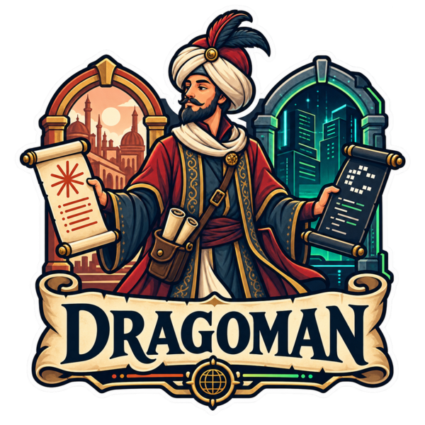

<p align="center"></p>

# Dragoman

A Claude Code plugin that translates between Claude and Codex so that Codex feels
native — its approvals, progress, and permissions feel like they were built into
Claude all along.

> A _dragoman_ was the **interpreter-diplomat** who let two courts speaking **different
languages** do business. That is exactly this tool's job.


## Why

Codex is a **different** agent with its own strengths — reach for it when a second,
independent one earns its keep. It shines at **large refactors and wide-blast-radius
changes**: call-site migrations, module restructures, sweeping changes that need
judgment at each site — exactly the big changes Claude tends to approach cautiously. It's
also a genuine outside pair of eyes for a second implementation, a review, or a deep
root-cause hunt. Dragoman lets Claude hand any of these to Codex and hear the answer
back in Codex's own voice.

But the official Codex plugin runs that agent with **approvals switched off**: it
hard-codes `approvalPolicy: never` and a fixed sandbox — read-only, or workspace-write
only when you pass `--write`. So Codex never asks you anything. Work that needs to step
outside that sandbox doesn't escalate — it just **fails**, and the model works around
it or gives up. And **none of Claude's permission mode, sandbox scope or settings reach
Codex**, so you run it on one fixed posture, not the guardrails you carefully set.

Dragoman extends Claude Code's own machinery — approvals, progress and permissions —
out to Codex:

| On the axes that matter | Official Codex plugin | Dragoman |
|---|---|---|
| Permissions, mode & sandbox | fixed posture, ignores Claude's settings | mirror Claude's live mode, sandbox & settings, per turn |
| Approvals | switched off — Codex never asks, out-of-sandbox work just fails | native async prompt in Claude's own UI, so Codex escalates under your rules |
| Progress | a phase and the tail of the raw log | a heartbeat of milestones — none of the noise |
| Steering a run | cancel only | steer it mid-flight, or stop it, without a restart |

## The idea in one line

**Mirror Claude, don't reinvent it.** Dragoman reads Claude Code's own settings and mirrors
them onto Codex per turn. It only asks you a question when Claude's own policy can't answer — and when it
does, it uses Claude's native approval prompt.

## What's mapped

Each Claude permission **mode** becomes a Codex posture:

| Claude mode | Codex behaviour |
|---|---|
| `plan` | Native Codex plan mode — reads run, writes refused at the source, no prompts |
| `default` / `manual` | Reads auto-run; every edit or write escalates to a native approval |
| `acceptEdits` | In-workspace edits auto-run; anything escaping the workspace escalates |
| `auto` | Escapes are judged by Codex's own safety classifier |
| `dontAsk` | Only pre-approved commands and reads run; everything else refused, never asked |
| `bypassPermissions` | Everything runs, unconfined — no sandbox, no prompts |

And each relevant **setting** is mirrored onto the Codex run:

| Claude Code | → Codex | |
|---|---|---|
| Permission mode | approval policy + reviewer + sandbox scope (above) | ✅ |
| Sandbox scope (read-only / workspace-write / danger) | permission-profile base | ✅ |
| `permissions.additionalDirectories` | `runtimeWorkspaceRoots` (writable roots) | ✅ |
| `sandbox.filesystem.allow`/`denyRead`/`denyWrite`/`allowWrite` | profile `filesystem` path→access table | ✅ |
| Network on/off (mirrors Claude's real posture) | profile `network.enabled` | ✅ |
| `sandbox.network.allowedDomains` / `deniedDomains` / `WebFetch(domain:)` | per-host allow/deny via Codex's network proxy | ✅ |
| `permissions.allow` Bash rules | auto-accept (execpolicy) | ✅ |
| `permissions.deny` Bash rules | pre-decline (execpolicy, fail-closed) | ✅ |
| Approvals for anything uncovered | **async native elicitation** | ✅ |
| Codex progress | **sparse heartbeat**, surfaced on poll | ✅ |

Mirroring runs against an **isolated `CODEX_HOME`** (auth inherited from `~/.codex`,
config = your config + a managed profile block), so it never touches your real
Codex config. Full per-setting detail — with the one mapping that can't be faithful
— is in [`docs/MAPPING.md`](docs/MAPPING.md); the design and ethos in
[`docs/DESIGN.md`](docs/DESIGN.md).

## Install

Dragoman is a Claude Code plugin. Add the marketplace and install it:

```
/plugin marketplace add danielbodart/dragoman
/plugin install dragoman@danielbodart 
```

That pulls one small archive (~5 MB) carrying a static binary for each
supported platform, and a launcher that picks the right one. Nothing else to
install: no runtime, no `jq`. Codex must be on your `PATH`, since Dragoman
spawns `codex app-server` (a SessionStart hook tells Claude if it isn't).

| Platform | Supported |
|---|---|
| Linux x86_64 | yes |
| Linux aarch64 | yes |
| macOS on Apple silicon (M1 and later) | yes |
| macOS on Intel | no |
| Windows | no: use [WSL](https://learn.microsoft.com/windows/wsl/), which is Linux |

On a platform it doesn't support, the plugin does nothing: its hooks stay
silent and the MCP server reports that it can't run there, so Claude Code
shows it as not connected.

Once installed you get:

- **`/dragoman:codex`** — the skill Claude loads to hand a task to Codex from the prompt.
- the **`dragoman:codex-agent` subagent** — Claude delegates to it for a second
  implementation, an independent review, or a deep investigation; it drives the
  run, follows the heartbeat, and reports back in Codex's voice.
- the underlying MCP tools (exposed as `mcp__plugin_dragoman_bridge__…`), if you'd
  rather drive Codex directly — **`codex_run`** to start a task and **`codex_status`**
  to follow it, plus the lifecycle tools **`codex_steer`** (nudge a running task),
  **`codex_cancel`** (stop one), and **`codex_continue`** (follow up on a finished
  task, on the same thread); **`codex_review`** for Codex's dedicated, prioritized
  code-review pass over a diff; and **`diagnostics`** for the live run + mirror view.

### From source

[mise](https://mise.jdx.dev) installs the Go toolchain; `./run` is the build:

```bash
mise install
mise run check                                             # gofmt, vet, generated protocol, unit tests
mise run build                                             # this machine's binary → dist/dragoman
claude mcp add dragoman -s user -- "$PWD/dist/dragoman" serve
mise run dist                                              # or the full plugin → dist/release/dragoman-plugin.zip
```

`mise run integration` runs the live tests against a real `codex`: the
model-free ones by default (`command/exec` in the sandbox), every one with
`DRAGOMAN_MODEL_TESTS=1`.

## Channels

- **Claude Code plugin**: `/plugin marketplace add danielbodart/dragoman`,
  then `/plugin install dragoman@danielbodart`. The marketplace points at the
  latest release's `dragoman-plugin.zip`, one archive carrying a static
  binary for Linux x86_64, Linux aarch64 and macOS on Apple silicon, with the
  launcher that picks one. Not Windows (use WSL) and not Intel Macs.
- **GitHub release**: `dragoman-plugin.zip` and `SHA256SUMS` on each
  [release](https://github.com/danielbodart/dragoman/releases), with a
  cosign keyless signature of each (`cosign verify-blob --bundle
  <asset>.sigstore.json --certificate-identity-regexp
  '^https://github.com/danielbodart/dragoman/'
  --certificate-oidc-issuer https://token.actions.githubusercontent.com
  <asset>`).
- **Nix**: nix-config fetches the release zip at build time; there is no
  flake here.

Updated weekly (Sunday 21:23 UTC): mise's tools to the latest patch of their
minor, and the Go modules, committed straight to `main` once the checks pass.
A release is cut when the Go source, `go.mod`/`go.sum`, `mise.toml`, `./run`,
`MAJOR`, `packaging/`, `skills/`, `agents/`, the plugin manifest or the
protocol schema changed since the last release (`RELEASE_PATHS` in
`mise.toml`), and only once `mise run check` and the plugin zip, unpacked and
run with the model-free live tests, pass on both Linux and macOS.

## Releases

**`main` is production.** Every push to it that changes what a release is
built from publishes, once CI passes on both platforms: there are no manual
tags and no release branches. The version is *derived from the repository*,
not stored in it: `major.commit-count.ci-run` (see `./run`). The major is the
one deliberate part (in `MAJOR`); the minor only ever rises and names exactly
one commit; the patch separates two builds of the same commit. `dragoman
version` reports what a build calls itself (`development` from source). Each
release is a GitHub Release `v<version>`, its notes the commits since the
last one, and a commit pointing `.claude-plugin/marketplace.json` at it. A
pull request builds and tests everything but publishes nothing.

```sh
./run version   # what this checkout would publish as
./run build     # compile dist/dragoman with the version baked in
./run dist      # every platform's binary and the plugin zip, into dist/
./run smoke     # the zip from dist/, unpacked and run through its launcher here
```

## License

Copyright 2026 Daniel Bodart. Licensed under the [Apache License 2.0](LICENSE).
